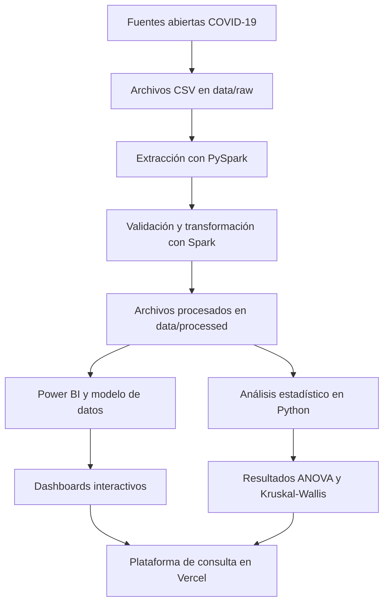

# Proyecto 6 — Seguimiento Epidemiológico de COVID-19 en Colombia

Link de Drive de Power Bi: https://drive.google.com/drive/folders/1GQMuJbYARe6oRxxJeuIaMHVOd747pXjX?usp=sharing


**ETL con Apache Spark (PySpark) · Modelado y visualización con Power BI · Análisis estadístico con Python**

> Proyecto académico desarrollado para la asignatura **Herramientas Computacionales**, Universidad Cooperativa de Colombia, campus Pasto, 2026.

## 🌐 Plataforma de dashboards

**[Abrir el despliegue público en Vercel](https://index-phi-virid.vercel.app/)**

La plataforma reúne la presentación del proyecto, el acceso al reporte de Power BI, la descripción del pipeline ETL y los resultados de las pruebas estadísticas. El enlace de Vercel es una **interfaz de publicación y consulta**; no reemplaza la ejecución local del ETL ni el archivo de trabajo `.pbix`.

## 1. Descripción del proyecto

Este proyecto implementa un flujo de **extracción, transformación y carga (ETL)** para preparar datos abiertos relacionados con la pandemia de COVID-19, analizarlos y representarlos mediante dashboards interactivos. Integra registros epidemiológicos, demográficos, etarios, ambientales y hospitalarios para estudiar la evolución de la pandemia y explorar diferencias entre grupos de edad en Colombia.

El procesamiento se realiza con **PySpark / Spark SQL**, la exploración visual se desarrolla en **Microsoft Power BI** y el contraste estadístico se efectúa con **Python**, utilizando pruebas de supuestos y métodos paramétricos y no paramétricos.

**Pregunta de investigación:** ¿Existen diferencias estadísticamente significativas entre las tasas de contagio de COVID-19 de los distintos grupos etarios en Colombia?

**Alcance temporal de los datos:** principalmente 2020–2022, con coberturas específicas distintas según el archivo de origen. No todas las fuentes tienen observaciones para todos los días del periodo.

## 2. Objetivos

### Objetivo general

Desarrollar un proceso reproducible de integración, limpieza, análisis estadístico y visualización de datos epidemiológicos de COVID-19, utilizando PySpark, Python y Power BI, para facilitar la interpretación de tendencias y diferencias entre grupos poblacionales.

### Objetivos específicos

1. Obtener conjuntos de datos públicos y organizar sus archivos de entrada.
2. Validar tipos de datos, fechas, claves, duplicados y valores faltantes.
3. Transformar y relacionar los datos de epidemiología, edad, demografía, clima y hospitalizaciones.
4. Preparar tablas procesadas para su análisis en Power BI.
5. Construir indicadores y visualizaciones epidemiológicas con DAX.
6. Evaluar estadísticamente las diferencias entre grupos etarios y documentar las limitaciones del análisis.
7. Publicar una interfaz de consulta que facilite el acceso a los dashboards y a los resultados.

## 3. Tecnologías y responsabilidades

| Herramienta | Uso en el proyecto |
| --- | --- |
| Python | Scripts ETL y análisis estadístico |
| Apache Spark / PySpark | Procesamiento y transformación de datos |
| Spark SQL | Consultas y operaciones sobre datos estructurados |
| Pandas | Manipulación de resultados estadísticos cuando corresponde |
| SciPy | Pruebas estadísticas |
| statsmodels | Pruebas/modelos estadísticos complementarios |
| Power BI Desktop | Modelado, medidas DAX, dashboards y reporte `.pbix` |
| Power Query | Preparación y validación adicional de tablas importadas |
| Vercel | Despliegue de la interfaz web de consulta |
| Git y GitHub | Versionamiento y publicación del repositorio, si se configura |

**Fuente principal:** Google Open COVID-19 Dataset. También se consideró el panel de la OMS como fuente de consulta del contexto epidemiológico; no se debe asumir que todos sus datos fueron integrados en el pipeline sin verificar los archivos procesados.

## 4. Arquitectura general



**Nota:** este esquema representa el flujo lógico del proyecto, no necesariamente un despliegue automatizado de extremo a extremo. La publicación web y el reporte Power BI tienen sus propios procedimientos de actualización.

## 5. Organización del repositorio

La estructura base utilizada durante el desarrollo es:

```text
Proyecto_6_Epidemiologia/
├── data/
│   ├── raw/
│   │   ├── epidemiology.csv
│   │   ├── by-age.csv
│   │   ├── demographics.csv
│   │   ├── index.csv
│   │   ├── weather.csv
│   │   └── hospitalizations.csv
│   └── processed/
├── etl/
│   ├── extraccion.py
│   ├── transformacion.py
│   └── carga.py
├── analisis_estadistico/
│   └── anova.py
├── evidencias/
├── requirements.txt
└── README.md
```

Los nombres corresponden a la **estructura base**. La versión final del repositorio puede contener archivos de salida, resultados estadísticos, configuraciones o recursos adicionales. El archivo de Power BI puede almacenarse por separado, pues no forma parte obligatoria de esta estructura.

### Responsabilidad de cada componente

- `data/raw/`: archivos originales, sin modificar manualmente.
- `etl/extraccion.py`: lectura y revisión inicial de las fuentes.
- `etl/transformacion.py`: limpieza, normalización, tipado, filtros y preparación de tablas.
- `etl/carga.py`: escritura de resultados para consumo posterior.
- `data/processed/`: datos preparados para análisis y visualización.
- `analisis_estadistico/anova.py`: ejecución del análisis de diferencias entre grupos etarios.
- `evidencias/`: capturas de ejecución, modelado y dashboards.
- `requirements.txt`: dependencias Python del proyecto.

## 6. Requisitos previos

Antes de iniciar, instalar:

1. **Python** en una versión compatible con la versión de PySpark del proyecto.
2. **Java JDK** compatible con Apache Spark y la distribución de PySpark utilizada.
3. **Git**, si se clonará el repositorio.
4. **Power BI Desktop**, en Windows, para abrir o editar el reporte.
5. Un editor de código como **Kiro** o **Visual Studio Code**.

Comprobar las instalaciones desde una terminal:

```bash
python --version
java -version
git --version
```

> Las versiones exactas deben fijarse de acuerdo con el `requirements.txt` definitivo y el entorno donde se validó el proyecto. No se ha verificado aquí una matriz de versiones concreta.

## 7. Inicialización paso a paso

### Paso 1. Obtener el código

Si el repositorio está publicado en GitHub:

```bash
git clone <URL_DEL_REPOSITORIO>
cd Proyecto_6_Epidemiologia
```

Si ya existe la carpeta local, abrir una terminal en `Proyecto_6_Epidemiologia`.

### Paso 2. Crear y activar un entorno virtual

**Windows (PowerShell):**

```powershell
python -m venv .venv
.\.venv\Scripts\Activate.ps1
```

**Linux/macOS:**

```bash
python3 -m venv .venv
source .venv/bin/activate
```

### Paso 3. Instalar dependencias

```bash
python -m pip install --upgrade pip
pip install -r requirements.txt
```

Las dependencias esperadas incluyen PySpark y bibliotecas de análisis estadístico como SciPy, Pandas y statsmodels. **La lista exacta de paquetes y versiones es la que figure en el archivo real `requirements.txt`.**

### Paso 4. Ubicar los datos de entrada

Comprobar que `data/raw/` contenga:

- `epidemiology.csv`: evolución de casos, fallecimientos y otras variables epidemiológicas.
- `by-age.csv`: indicadores por grupos etarios.
- `demographics.csv`: información demográfica y denominadores poblacionales.
- `index.csv`: identificadores y referencias geográficas.
- `weather.csv`: variables ambientales.
- `hospitalizations.csv`: indicadores hospitalarios y de atención.

Las columnas disponibles dependen de la versión descargada de cada fuente. Conservar una copia original y registrar su procedencia.

### Paso 5. Ejecutar el ETL

La siguiente secuencia corresponde a la estructura modular propuesta:

```bash
python etl/extraccion.py
python etl/transformacion.py
python etl/carga.py
```

**Importante:** estos comandos suponen que cada archivo contiene un punto de entrada ejecutable y que las rutas se resuelven desde la raíz del proyecto. Si la implementación real usa funciones importadas, argumentos obligatorios o un script orquestador, adaptar el procedimiento según el código. No se ha comprobado la ejecución de los scripts en este README.

Verificar después la creación de los archivos en `data/processed/`, el número de filas, las columnas, los formatos y los registros de errores.

### Paso 6. Ejecutar el análisis estadístico

```bash
python analisis_estadistico/anova.py
```

Verificar la salida del script: estadísticas descriptivas, resultados de las pruebas, valores p y archivos que se importarán a Power BI. La ubicación y los nombres exactos de los archivos de resultados dependen de la implementación del script.

### Paso 7. Abrir Power BI

1. Abrir **Power BI Desktop**.
2. Abrir el archivo `.pbix` del proyecto, si ya existe, o crear un reporte nuevo.
3. Ir a **Inicio → Obtener datos → Texto/CSV** y seleccionar los archivos procesados.
4. Utilizar **Transformar datos** para revisar nombres de columnas, tipos, valores nulos y duplicados.
5. En **Power Query**, revisar las rutas de origen; actualizarlas si los archivos están en otra carpeta.
6. Seleccionar **Cerrar y aplicar**.
7. Configurar relaciones, medidas DAX, segmentadores y visualizaciones.
8. Actualizar el modelo y guardar el archivo `.pbix`.

## 8. Implementación del ETL

### 8.1 Extracción

Los archivos de entrada se leen desde `data/raw/` mediante el entorno de Spark. Se comprueba la existencia de los archivos, la estructura de columnas y los tipos iniciales. Es conveniente registrar errores de lectura y conteos por fuente.

### 8.2 Transformación

Las tareas de preparación incluyen:

- Conversión de fechas a tipos adecuados.
- Verificación de identificadores geográficos, como `location_key`.
- Revisión de valores nulos y duplicados según la clave de cada conjunto.
- Estandarización de nombres y tipos de columnas.
- Filtrado geográfico y temporal cuando el análisis lo requiere.
- Integración de variables epidemiológicas, demográficas, etarias, ambientales y hospitalarias.
- Preparación de indicadores y tablas destinadas a Power BI.

**Atención:** eliminar filas duplicadas requiere definir primero la clave de negocio. No todos los registros repetidos en una columna aislada son errores; por ejemplo, un grupo de edad debe aparecer en múltiples fechas.

### 8.3 Carga

Los resultados se escriben en archivos procesados que Power BI puede importar. En Spark, una escritura CSV puede producir **una carpeta con varios archivos `part-*.csv`**, en vez de un único CSV; revisar la salida real antes de configurar las rutas del reporte.

### 8.4 Validación de calidad

Comprobar, como mínimo:

| Control | Qué revisar |
| --- | --- |
| Esquema | Columnas obligatorias y tipos esperados |
| Integridad | Claves geográficas y fechas no nulas cuando sean obligatorias |
| Duplicados | Unicidad de claves compuestas relevantes |
| Cobertura | Fechas mínimas y máximas por conjunto |
| Consistencia | Casos, fallecimientos y tasas dentro de rangos plausibles |
| Trazabilidad | Fuente y fecha de obtención de cada archivo |
| Carga | Archivos de salida accesibles desde Power BI |

## 9. Modelado en Power BI

El modelo analítico incorpora tablas de hechos y dimensiones. Entre las tablas presentadas en la plataforma publicada se encuentran:

- `epidemiologia`
- `datos_por_edad`
- `clima`
- `hospitalizaciones`
- `demografia`
- `dim_fecha`
- `dim_ubicacion`
- `dim_edad`
- `Medidas_KPI`

**Dimensiones:** aportan atributos para filtrar, agrupar y contextualizar los registros (fecha, ubicación y edad).

**Hechos:** contienen métricas cuantitativas asociadas a fechas, lugares o grupos, según la granularidad de cada tabla.

**Recomendación de modelado:** definir relaciones por claves compatibles y evitar relaciones muchos-a-muchos accidentales. Confirmar que los filtros no produzcan duplicaciones en las medidas.

### Ejemplos de indicadores DAX

La plataforma pública destaca indicadores denominados `Total_Casos`, `Tasa_Letalidad`, `Fecha_Pico_Epidemiologico` y `Grupo_Edad_Mas_Casos`.

Las expresiones exactas deben consultarse en el archivo `.pbix`. A nivel conceptual:

- **Total de casos:** suma de registros de casos bajo los filtros seleccionados.
- **Tasa de letalidad:** cociente entre fallecimientos y casos, con protección ante divisiones por cero.
- **Fecha del pico epidemiológico:** fecha que presenta el máximo del indicador diario seleccionado.
- **Grupo de edad con más casos:** categoría etaria con mayor valor de casos según el contexto de filtros.

No confundir **casos acumulados**, **casos nuevos** y **tasas por 100 000 habitantes**: son medidas diferentes.

## 10. Dashboards y navegación

La plataforma de despliegue documenta las siguientes páginas del reporte epidemiológico:

| Página | Propósito |
| --- | --- |
| **01 — Resumen epidemiológico** | Presentar indicadores generales y panorama de la pandemia |
| **02 — Perfil demográfico** | Explorar diferencias por grupos poblacionales |
| **03 — Temporal y ambiental** | Examinar evolución temporal y variables ambientales |
| **Validación del modelo** | Mostrar verificaciones del modelo analítico |

Además, la plataforma presenta un módulo de **análisis estadístico ANOVA / Kruskal-Wallis** con resultados y conclusiones. La organización exacta de páginas dentro del `.pbix` puede diferir de los apartados de la página web.

**Acceso:** https://index-phi-virid.vercel.app/

Para editar las visualizaciones se necesita el archivo `.pbix` original y acceso a las fuentes de datos; la página desplegada está orientada a consulta.

## 11. Análisis estadístico: ANOVA y Kruskal-Wallis

### 11.1 Pregunta e hipótesis

Se investiga si existen diferencias en las **tasas de contagio por 100 000 habitantes** entre nueve grupos etarios de Colombia.

- **H₀:** las distribuciones de las tasas de contagio son iguales entre los grupos.
- **H₁:** al menos un grupo presenta una distribución diferente.
- **Nivel de significancia:** `α = 0.05`.

### 11.2 Pruebas y criterio de selección

1. **Shapiro-Wilk:** evalúa la compatibilidad de los datos con la normalidad.
2. **Levene:** contrasta la homogeneidad de las varianzas.
3. **ANOVA clásico:** contraste paramétrico de medias bajo sus supuestos.
4. **ANOVA de Welch:** alternativa paramétrica que permite varianzas diferentes.
5. **Kruskal-Wallis:** contraste no paramétrico utilizado como prueba principal cuando no se cumplen los supuestos requeridos para el análisis paramétrico convencional.

La plataforma publicada indica que se rechazaron los supuestos de normalidad y homogeneidad de varianzas, por lo que **Kruskal-Wallis** fue la prueba principal; ANOVA clásico y Welch se conservaron como referencias complementarias.

### 11.3 Resultados publicados

| Prueba | Estadístico reportado | Interpretación dentro del proyecto |
| --- | --- | --- |
| Shapiro-Wilk | `p ≈ 0` en los nueve grupos | Evidencia contra normalidad |
| Levene | `W = 109.79`, `p ≈ 0` | Evidencia de heterogeneidad de varianzas |
| Kruskal-Wallis | `H = 894.27`, `p < 2.2 × 10⁻¹⁶` | Prueba principal; rechazo de H₀ |
| Welch ANOVA | `F = 324.44`, gl `(8, 2427)`, `p < 2.2 × 10⁻¹⁶` | Contraste complementario |
| ANOVA clásico | `F = 97.57`, gl `(8, 6112)`, `p < 2.2 × 10⁻¹⁶` | Contraste complementario |

**Observaciones analizadas:** 6 121 registros, distribuidos en nueve grupos etarios. El grupo **30–39 años** presenta la mayor tasa media publicada: **24.15 casos por 100 000 habitantes**.

> `p ≈ 0` es una forma abreviada de representar un valor muy pequeño; no significa que la probabilidad sea literalmente cero.

### 11.4 Estadísticas descriptivas por grupo

| Edad | Observaciones | Media (casos/100k) | Desviación estándar |
| --- | ---: | ---: | ---: |
| 0–9 | 671 | 3.98 | 3.66 |
| 10–19 | 680 | 7.76 | 7.83 |
| 20–29 | 682 | 20.25 | 20.30 |
| 30–39 | 685 | 24.15 | 24.22 |
| 40–49 | 681 | 22.14 | 22.82 |
| 50–59 | 684 | 20.56 | 20.76 |
| 60–69 | 681 | 18.68 | 17.73 |
| 70–79 | 681 | 17.43 | 15.42 |
| 80+ | 676 | 16.97 | 14.59 |

### 11.5 Interpretación y límites

El resultado de Kruskal-Wallis aporta evidencia estadística de diferencias entre distribuciones etarias. **No identifica por sí solo qué pares de edades difieren**: para ello se necesitan comparaciones post-hoc apropiadas, por ejemplo Dunn con ajuste por multiplicidad.

Además, las observaciones son registros diarios consecutivos y pueden presentar **dependencia temporal**. Por ello, el valor p debe interpretarse con cautela: la significación no demuestra causalidad ni elimina los posibles efectos de autocorrelación, cambios de registro o factores de confusión.

Las tasas utilizadas se describen en la plataforma como:

```text
Tasa por 100 000 = (casos nuevos / población del grupo etario) × 100 000
```

Antes de replicar los resultados, comprobar que el numerador y el denominador correspondan al mismo ámbito geográfico, grupo y periodo.

## 12. Despliegue y publicación

**Despliegue público verificado:** [https://index-phi-virid.vercel.app/](https://index-phi-virid.vercel.app/)

La interfaz web permite consultar información del proyecto, el acceso a Power BI y el análisis estadístico. La plataforma está alojada en Vercel; **no se ha inspeccionado el código fuente del frontend**, por lo que no se especifican framework, scripts `npm` ni variables de entorno como si estuvieran confirmados.

Para reproducir o actualizar el despliegue web, revisar el repositorio específico del frontend y sus archivos de configuración (`package.json`, configuración de Vercel y variables de entorno, si existen). El proceso general consiste en actualizar el contenido, verificar localmente el frontend, publicar los cambios y confirmar que los enlaces al reporte de Power BI funcionen.

**Importante:** volver a ejecutar el ETL no actualiza automáticamente los dashboards publicados. Para actualizar los datos visualizados también es necesario refrescar y volver a publicar el reporte, de acuerdo con la configuración de Power BI.

## 13. Guía de verificación final

- [ ] Los seis CSV originales están disponibles en `data/raw/`.
- [ ] El entorno virtual se activa correctamente.
- [ ] Las dependencias se instalan sin errores.
- [ ] Los scripts ETL se ejecutan en el orden exigido por el código.
- [ ] Los archivos procesados se generan y validan.
- [ ] El script estadístico produce resultados reproducibles.
- [ ] El reporte de Power BI carga las tablas y relaciones esperadas.
- [ ] Las medidas DAX muestran valores consistentes.
- [ ] Los dashboards presentan títulos, unidades y filtros correctos.
- [ ] Las pruebas estadísticas, conclusiones y limitaciones son visibles.
- [ ] El enlace de Vercel abre correctamente.
- [ ] El enlace al reporte de Power BI es accesible para el público previsto.
- [ ] El repositorio no contiene credenciales ni archivos sensibles.

## 14. Problemas frecuentes

**`python` no se reconoce:** verificar instalación, PATH o utilizar `py` en Windows.

**Error relacionado con Java/Spark:** comprobar `java -version`, la compatibilidad con PySpark y la configuración de Java.

**No se encuentra un CSV:** ejecutar los comandos desde la raíz del proyecto y revisar las rutas usadas en los scripts.

**Spark genera una carpeta en vez de un CSV único:** es el comportamiento habitual de escritura distribuida; revisar los archivos `part-*`.

**Power BI no encuentra el origen:** modificar la ruta de los archivos en la configuración del origen o en Power Query.

**Power BI tarda en aplicar cambios:** revisar volumen de datos, pasos de Power Query, consultas duplicadas y recursos del equipo.

**Los indicadores se duplican:** comprobar granularidad, relaciones y dirección de filtrado.

**El reporte publicado no muestra los datos más recientes:** revisar actualización del conjunto de datos y publicación del reporte; Vercel y Power BI se actualizan por separado.

## 15. Equipo académico

**Estudiantes:**

- Helen Alejandra Moncayo Delgado
- María Juliana Rodríguez Andrade

**Asignatura:** Herramientas Computacionales  
**Docente:** Cristian Camilo Ordoñez  
**Institución:** Universidad Cooperativa de Colombia  
**Ciudad:** San Juan de Pasto, Nariño, Colombia  
**Año:** 2026

## 16. Referencias y recursos

- [Plataforma pública del proyecto](https://index-phi-virid.vercel.app/)
- [Google Open COVID-19 Data](https://github.com/GoogleCloudPlatform/covid-19-open-data)
- [Panel de COVID-19 de la OMS](https://data.who.int/dashboards/covid19)
- [Documentación de Apache Spark](https://spark.apache.org/docs/latest/)
- [Documentación de Power BI](https://learn.microsoft.com/power-bi/)
- [Documentación de SciPy](https://docs.scipy.org/doc/scipy/)

---

### Notas de reproducibilidad

Este README combina la **estructura de proyecto y decisiones técnicas descritas durante el desarrollo** con la **información estadística visible en el despliegue público**. No se ha realizado una auditoría del repositorio ni una ejecución de sus scripts. Para convertir esta guía en documentación totalmente reproducible, completar el enlace del repositorio, fijar las versiones exactas, confirmar los argumentos y salidas de cada script, e incluir las instrucciones reales del frontend si también se publicará su código.
